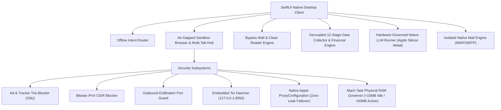

# Aegis 🛡️
> Native macOS Sovereign Security Architecture, Sandboxed Browser & Offline Intelligence Engine

Aegis is an ultra-lightweight, high-performance native macOS security application and browser engineered in Swift. Built on a strict zero-trust foundation, Aegis combines hardened WebKit sandboxing, bitwise network enforcement, in-app encrypted proxying, embedded Tor routing, hardware-governed local LLM execution, and an institutional-grade financial data synthesis pipeline with complete provenance and non-substitution guarantees.

---

## Architecture Overview



---

## Key Subsystems

### 1. Air-Gapped Sandboxed Browser
- **Ephemeral Sessions:** WebKit data store configured with zero persistent disk caching or history tracking.
- **Multi-Tab Architecture:** Dynamic tab switching, hibernation, and clean resource deallocation.
- **Device Desert Vault:** Quarantines downloaded payloads, strips execution bits (`chmod 0600`), and enforces Apple quarantine flags (`com.apple.quarantine`).

### 2. High-Performance Network Security
- **Ad & Tracker Blocker:** Inverted domain trie matching in $O(k)$ character complexity with zero heap allocations on the hot path.
- **Bitwise CIDR IP Blocker:** Real-time IPv4 mask evaluation intercepting malicious ranges and bogons in nanoseconds.
- **Outbound Leak Guard:** Blocks data exfiltration across sensitive local and remote ports.
- **ISP Cloak Proxy & Tor:** Native Apple `Network.ProxyConfiguration` supporting SOCKS5 and HTTP CONNECT with failover prevention, plus one-click embedded Tor daemon lifecycle management.

### 3. Bypass Wall & Clean Reader Engine
- **Non-Circumventing Content Extraction:** Exposes publicly retrievable text blocked by presentation-level login/signup modal overlays.
- **Strict Access-Control Defense:** Strictly halts when encountering paid subscription paywalls, CAPTCHAs, or authenticated corporate portals.
- **DOM Sanitization:** Strips 100% of inline scripts, malicious event handlers, and tracking payloads.

### 4. Decoupled 12-Stage Data Collector & Financial Engine
- **Strict Non-Substitution Guard:** Eliminates silent entity substitution; halts immediately with `ENTITY_UNVERIFIED` if an entity cannot be identified.
- **Entity-Aware Discovery:** Dynamically selects authoritative sources (SEC EDGAR XBRL, Yahoo Finance API, GitHub REST) tailored to public equities, private corporations, or open-source software projects.
- **Source Ledger & Independence Accounting:** Distinguishes between 9 lifecycle stages (Requested, Discovered, Candidate, Selected, Accessed, Extracted, Validated, Used, Rejected) and groups sources by domain clustering.
- **Provenanced Facts & Backward Lineage:** Computes financial models (Altman Z-Score, Piotroski 9-Factor F-Score, DuPont 3-Step ROE Decomposition, DCF Intrinsic Valuation) strictly from verified facts. Injects zero dummy constants; missing inputs strictly report `DATA UNAVAILABLE`.

### 5. Hardware-Governed Native LLM Engine
- **Local Apple Silicon Metal Offload:** Direct in-app inference with zero cloud dependencies.
- **Granular Resource Budgets:** Configurable RAM/VRAM ceilings, Metal GPU layer allocation, and CPU thread controls per model category (Ultra-Light, Balanced, Deep Reasoning).

### 6. Isolated Native Mail Client
- Clean, segregated desktop client for IMAP IDLE real-time push and TLS SMTP delivery across Google, Microsoft, and Apple providers.
- Local account deletion removes local credentials and caches with zero destructive impact on remote mail servers.

---

## Building & Packaging

### Prerequisites
- macOS 14.0+ (Sonoma or Sequoia)
- Apple Silicon (M1/M2/M3/M4) or Intel Mac
- Xcode 15+ / Command Line Tools (`swift build`)
- Optional for bundled binary features: Homebrew (`tor`, `llama.cpp`)

### Build & Package Native App
Run the automated packaging script to build the release binary, package macOS bundles, link dynamic libraries, and code-sign:

```bash
./build_app.sh
```

Launch the bundled application:
```bash
open Aegis.app
```

---

## Verification & Self-Test Suite

Aegis includes a built-in diagnostic test runner validating all 16 security and subsystem modules:

```bash
./Aegis.app/Contents/MacOS/Aegis --self-test
```

### Run Live Financial Intelligence Crawl
```bash
# Public Equity (Ford)
./Aegis.app/Contents/MacOS/Aegis --crawl-test "financial analysis of Ford"

# Public Equity (Tesla)
./Aegis.app/Contents/MacOS/Aegis --crawl-test "financial analysis of Tesla"

# Private Company (Stripe)
./Aegis.app/Contents/MacOS/Aegis --crawl-test "financial analysis of Stripe"

# Open-Source Tech Project (Kubernetes)
./Aegis.app/Contents/MacOS/Aegis --crawl-test "Analyze Kubernetes project"

# Unverified Entity (Safely Refuses)
./Aegis.app/Contents/MacOS/Aegis --crawl-test "financial analysis of NonExistentCorpXYZ"
```

---

## Security & Privacy Policy

Aegis operates under an absolute zero-trace standard:
- No tracking or telemetry.
- No third-party analytics SDKs.
- No synthetic mock data in analytical reports.
- Hardware governor enforces physical RAM footprint $<15\text{ MB}$ idle, $<50\text{ MB}$ under normal browsing.

---

## License

All rights reserved. Designed for sovereign privacy, high security, and verifiable institutional computing.
